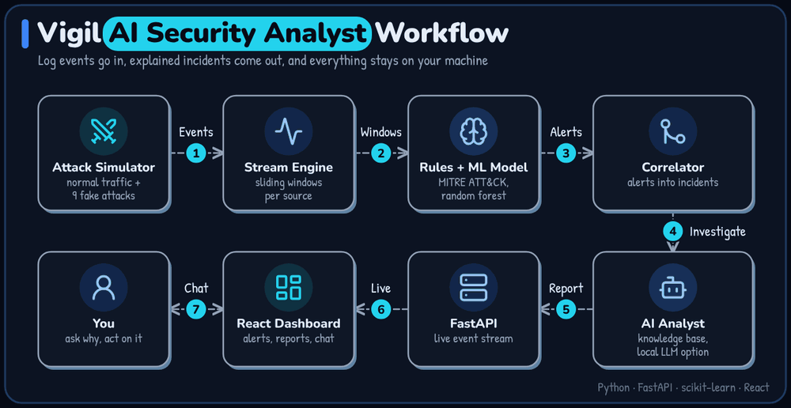

# Vigil

A small AI security analyst you can run on your own machine. It watches a live stream of log events, detects attacks with rules and a trained model, groups alerts into incidents, explains them, and answers questions in a chat.



Everything is simulated. The attacks are generated log records, not network traffic, and they use reserved documentation addresses (RFC 5737) and `.example` domains, so nothing can reach a real system.

## Run it

You need Python 3.10 or newer. Node is only needed if you change the dashboard, because the built version is included.

On Windows, double-click `run.bat`, or:

```bash
python -m venv .venv
.venv\Scripts\activate          # macOS or Linux: source .venv/bin/activate
pip install -r requirements.txt
python run.py
```

The first start trains the model, which takes under a minute. The dashboard then opens at http://127.0.0.1:8765. Press any button under **Launch a fake attack**, and try **Full intrusion** first.

## What it detects

| Fake attack | Technique | How it is caught |
|---|---|---|
| Password guessing | T1110.001 | Rule + model |
| Credential stuffing | T1110.004 | Rule + model |
| Login after many failures | T1078 | Rule |
| Port scan | T1046 | Rule + model |
| SQL injection and path probes | T1190 | Signature + model |
| DNS tunneling | T1071.004 | Rule + model |
| Malware beaconing | T1071.001 | Rule + model |
| Data exfiltration | T1048 | Rule + model |
| Prompt injection hidden in logs | AML.T0051 (MITRE ATLAS) | Signature |
| Full intrusion | Several of the above | Linked into one incident |

The prompt injection case targets the analyst itself: an attacker writes instructions into a log field, hoping the AI obeys them. Vigil treats log text as data, flags the attempt, removes the text before any model reads it, and keeps severity decisions in code so no model output can change them.

## Results

Measured with `python scripts/train.py` on test runs the model never trained on. An attack counts as caught only if the correct attack type is identified. Each of the 9 scenarios ran 8 times at normal strength and 8 times in a slower, quieter version.

| | Normal | Stealthy | Total |
|---|---|---|---|
| Rules alone | 72 / 72 | 67 / 72 | 139 / 144 |
| Rules + ML model | 72 / 72 | 72 / 72 | 144 / 144 |

- False alerts on normal traffic: 0 per simulated hour with rules alone, 0.17 with the model. So the model adds coverage and speed, at the cost of a few false alarms.
- Attacks the model never saw: with one attack type removed from training, the model alone still flagged 3 of 7 types in at least 9 of 10 runs (brute force, credential stuffing, web injection). It flagged none of the other 4 (port scan, DNS tunneling, beaconing, exfiltration), so it is weak on truly new attacks. Rules still cover those four. Exact counts are in `reports/metrics.json`.
- Normal traffic includes deliberately tricky cases: forgotten passwords, backups, cloud-sync apps, approved uploads and CDN names.

These numbers come from a simulator, so they show the system works as designed, not how it would perform on a real network.

## Test it

```bash
python scripts/attack_test.py     # plays every fake attack and prints a pass/fail table
pip install -r requirements-dev.txt
pytest                            # 53 automated tests
```

## How it works

1. `vigil/simulator.py` generates normal traffic and labeled attacks.
2. `vigil/engine.py` processes events one at a time, with sliding windows per source (`vigil/features.py`).
3. `vigil/rules.py` applies explainable rules. `vigil/model.py` adds a random forest for known attacks and an isolation forest for unusual behaviour.
4. The engine groups alerts into incidents by shared IP addresses and accounts.
5. `vigil/analyst.py` writes the report using `vigil/knowledge/`, and answers chat questions.
6. `vigil/server.py` streams everything to the React dashboard in `frontend/`.

## Using a local AI model

By default the analyst is offline: every sentence is built from real alert data and the knowledge base, so it cannot invent facts, but it is a template and not a language model. To have a local model write the summaries, install [Ollama](https://ollama.com), pull a model, and start Vigil with it:

```bash
ollama pull llama3.2
set OLLAMA_MODEL=llama3.2       # macOS or Linux: export OLLAMA_MODEL=llama3.2
python run.py
```

Logs stay on your machine. If the model is unavailable or says an incident is safe, Vigil falls back to the offline report. This path is tested against a stand-in server, not a real model yet.

## Limits

- It reads simulated events only. Real log sources are not connected yet.
- It recommends actions and never performs them.
- The stream runs inside one Python process. Kafka and Flink are not used in this version, because a simple in-process stream keeps it one command to run. The engine takes one event at a time, so a Kafka consumer can feed it later.
- The dashboard binds to localhost and has no login, so do not expose it to a network.
